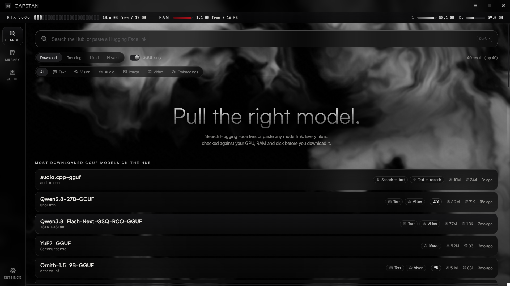
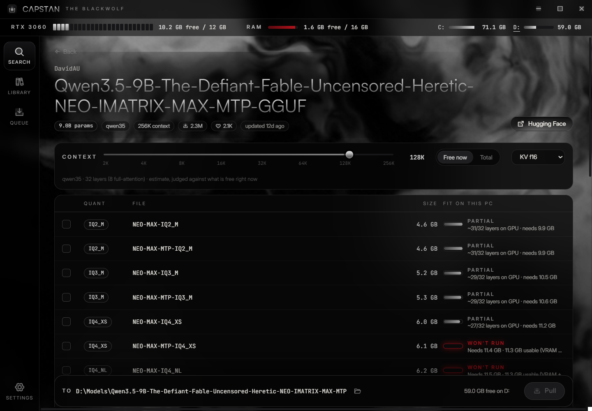

<p align="center">
  
</p>

<h1 align="center">Capstan</h1>

<p align="center"><sub>CΛPSTΛN · by DΛЯK · The BlackWolf</sub></p>

<p align="center">
  <b>Find and download models from Hugging Face, and know whether they'll run on your PC before you download them.</b><br>
  A Windows desktop app for people who run local models with llama.cpp, LM Studio or Ollama.
</p>

<p align="center">
  
</p>

---

## Why

> A **capstan** is the winch that hauls a heavy load in under tension, steadily and under control. That's the job: pull big models in, one verified byte at a time, only once you know they'll fit.

You find a GGUF repo with twenty quants. Which one fits on your GPU? At what context? Download a 10 GB file to find out, and on a 12 GB card the answer is often "not quite".

Capstan answers that **before** the download. It reads each model's header straight from Hugging Face (a few MB, not the model), then checks weights, KV cache and overhead against **what is free on your machine right now**.

## Features

- **Live Hub search** as you type. GGUF only by default; sort by downloads, trending, likes or newest.
- **Know what a model does:** every result carries type badges (Text, Vision, Speech-to-text, Text-to-speech, Music, Image gen, Video gen, Embeddings…), and a type filter narrows Search to one kind. Untagged repos are classified from their tags and files (an `mmproj` means vision), so filtering never hides them.
- **Paste any link:** a repo ID (`owner/name`), a `huggingface.co/...` URL, or a direct file link. The repo opens straight away.
- **Machine strip:** VRAM free right now and which model runner is holding it (Ollama, LM Studio, llama.cpp…), plus RAM and free space on every drive. Refreshes every 2 s.
- **A fit light on every file:**

  | Light | Meaning |
  |---|---|
  | **Fits** | Everything on the GPU, with a 5% safety margin |
  | **Partial** | Spills to RAM; shows about how many layers stay on the GPU |
  | **Won't run** | Bigger than free VRAM + RAM together |
  | **DISK** | The destination drive doesn't have room |

  A **context slider** (2K up to the model's maximum), **Free now / Total**, and **KV cache f16 / q8_0 / q4_0** update every light live.
- **Resumable, verified downloads.** Pausing keeps a `.part` file, and resuming continues from the same byte. Every file is checked against Hugging Face's SHA-256. Files keep their real names, in the folder you choose (no hashed blobs).
- **Split GGUFs** (`-00001-of-00003`) count as one model; **mmproj** vision projectors are listed separately.
- **Library** of everything in your model folders: show in folder, copy path, open the source repo, or move to the Recycle Bin.
- **Gated repos** work with your `hf auth login` token.

<p align="center">
  
</p>

## How the fit check works

1. **Read the header.** HTTP range requests fetch only the GGUF metadata from Hugging Face: layer count, attention and KV heads, head sizes, context length, sliding-window and hybrid-layer settings.
2. **Add it up:**
   - **weights** = the file size
   - **KV cache** = full-attention layers × context, plus sliding-window layers × their window, plus the fixed recurrent state of linear-attention layers (hybrid models such as Qwen3.5)
   - **overhead** = CUDA context + compute buffer (it grows with vocabulary and context)
3. **Compare** with free VRAM (and RAM for partial offload). "Partial" estimates how many layers fit on the GPU, the way llama.cpp offloads them.

**Checked against llama.cpp:** Llama 3.2 3B at 8K context comes out at 896 MiB of KV cache, the same figure llama.cpp reports. It is still an estimate: backends differ slightly, so "Fits" keeps a margin.

## Install

**Needs:** Windows 10 (version 2004 or later) or Windows 11, 64-bit. Edge WebView2 is built into Windows 11 and arrives with updates on Windows 10; if the window stays blank on an older or LTSC Windows 10, install the [WebView2 Runtime](https://developer.microsoft.com/microsoft-edge/webview2/). An NVIDIA GPU is needed for the VRAM readings and fit lights; without one the app still searches and downloads.

### Microsoft Store (recommended)

Search for **Capstan** in the Microsoft Store, or use the link on the [releases page](https://github.com/Vullki/capstan/releases/latest). The Store build is signed by Microsoft and updates itself.

### Installer from GitHub

Download **`Capstan-<version>-Setup.exe`** from the [latest release](https://github.com/Vullki/capstan/releases/latest) and run it. It installs for your user only (no admin prompt) and adds Capstan to the Start menu. Python isn't needed: the app carries its own runtime.

The installer isn't code-signed, so Windows SmartScreen will say "Windows protected your PC" the first time. Choose **More info → Run anyway**, or get the Store build, which has no warning. Uninstalling keeps your settings and every model you downloaded.

### From source

Needs Python 3.11+ (developed and tested on 3.14).

```powershell
git clone https://github.com/Vullki/capstan.git
cd capstan
python -m pip install -r requirements.txt
```

Run it: double-click **`Capstan.bat`**, or create a Desktop shortcut with the icon:

```powershell
Set-ExecutionPolicy -Scope Process Bypass; .\tools\install-shortcut.ps1 -StartMenu
```

To build the installer and the Store package yourself, see [`packaging/README.md`](packaging/README.md).

**Launch options** (for the installed `Capstan.exe` or `Capstan.bat`):

| Option | Does |
|---|---|
| `--open <repo or link>` | Opens a repo at start, e.g. `--open bartowski/Llama-3.2-3B-Instruct-GGUF` |
| `--view library` | Starts on Library (also `queue`, `settings`) |
| `--debug` | WebView dev tools (from source, `Capstan (debug).bat` also shows a console) |

**Gated models:** paste a Hugging Face read token in **Settings → Hugging Face account** (or run `hf auth login` once, if you have the CLI).

**First run:** Capstan downloads its display font (Satoshi) from Fontshare once, in the background, into its data folder. Until then, and if you're offline, it uses the bundled Inter Display.

## Where things live

| What | Where |
|---|---|
| Downloads | `D:\Models\<model>` by default (`%USERPROFILE%\Models` when there's no D:). Change it in Settings. |
| Settings, queue, history, header cache, Satoshi | `%APPDATA%\Capstan\` (set `CAPSTAN_DATA` to use another folder) |
| The same, for the Microsoft Store build | Windows keeps a packaged app's data apart: `%LOCALAPPDATA%\Packages\<Capstan package>\LocalCache\Roaming\Capstan\`. It's removed when you uninstall the Store app. |

## Project layout

```
app/
  main.py            window (pywebview, frameless) + taskbar identity
  api.py             the bridge the UI calls; window drag/resize
  core/
    hub.py           search (with the type filter), link parsing, file listing, quant grouping
    modeltype.py     what a model does: type badges and filter buckets from Hub metadata
    gguf.py          GGUF header reader over HTTP range requests
    fit.py           memory estimate
    machine.py       GPU (NVML), RAM, drives
    downloads.py     queue: one worker process per file
    worker.py        resumable downloader with SHA-256 check
    store.py         settings, history, header cache, library scan
  ui/                index.html, app.css, app.js, mist.js, tokens.css, assets/
design/
  DESIGN.md          the Brushed Silver Noir design system the UI follows
  icon/              app icon: SVGs, .ico and PNG sizes (16–1024)
tests/               unittest suite: python -m unittest discover -s tests
packaging/
  build.ps1          one command: app bundle, GitHub installer, Store package
  capstan.spec       PyInstaller recipe (Satoshi is never bundled)
  installer/         Inno Setup script for Capstan-<version>-Setup.exe
  msix/              Store manifest, logo set and its generator
  store/             Microsoft Store listing text and privacy policy
tools/
  install-shortcut.ps1, capture.py
docs/superpowers/    design specs and implementation plans
```

## Design

The interface follows **Brushed Silver Noir**, The BlackWolf's design system: a pure black stage, glass surfaces, brushed-silver metal type, and almost no colour. The one exception is the crimson wolf eye, which marks "Won't run". Behind it all moves a live **Mist** shader, kept light (half resolution, 24 fps, paused when hidden) so the GPU stays free for your models. See [`design/DESIGN.md`](design/DESIGN.md).

The icon, by The BlackWolf, draws the capstan's job: a brushed-silver block lowered into its bay. Sources and every size are in [`design/icon/`](design/icon/).

## Limitations

- **Windows only for now.** The window handling and drive scan use Win32.
- **Fit lights are for GGUF.** Other formats download fine but show no estimate.
- **NVIDIA only** for VRAM readings (NVML).

## Credits

- [huggingface_hub](https://github.com/huggingface/huggingface_hub) · [pywebview](https://pywebview.flowrl.com/) · [psutil](https://github.com/giampaolo/psutil) · [nvidia-ml-py](https://pypi.org/project/nvidia-ml-py/)
- Icons: [Phosphor](https://phosphoricons.com/) (MIT)
- Fonts: [Inter](https://rsms.me/inter/), [Plus Jakarta Sans](https://fonts.google.com/specimen/Plus+Jakarta+Sans) and [JetBrains Mono](https://www.jetbrains.com/lp/mono/) are bundled (SIL OFL 1.1). [Satoshi](https://www.fontshare.com/fonts/satoshi) by Indian Type Foundry is **not** bundled: its license doesn't allow redistribution, so Capstan fetches it from Fontshare on first run.

## License

[MIT](LICENSE) © 2026 The BlackWolf (DΛЯK). Bundled fonts and icons keep their own licenses (see [THIRD_PARTY_NOTICES.md](THIRD_PARTY_NOTICES.md)).

## Changelog

See [CHANGELOG.md](CHANGELOG.md).

---

<p align="center"><sub>Made by <b>The BlackWolf</b> · #DΛЯK_MUSIC 🐺</sub></p>
